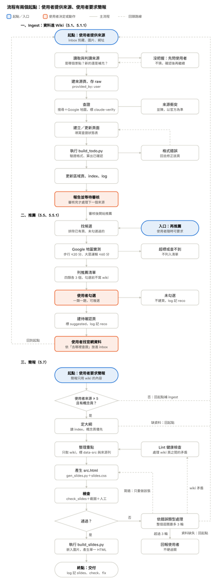

# 旅遊景點 LLM Wiki：江之島新手導覽

## LLM Wiki 主題與簡短介紹

這次做出一個旅遊景點 LLM Wiki，把景點營業時間、票價等官網上的資訊整理成一份份景點筆記。

從一個江之島海邊景點開始，先用 AI 把附近步行距離近的景點資料整理出來，再逐步擴充。

- **內容**：6 個景點、2 家餐廳、1 家咖啡廳甜點、4 個概念頁（江之島是什麼、怎麼去江之島、住宿地區、逛江之島的注意事項）。
- **來源**：AI 推薦的景點，我自己再去查有沒有官網資料。我從官網與資料頁剪藏了 13 份資料，另有 AI 自己搜尋的網頁資料作為查證用。
- **特色**：每個欄位（營業時間、費用、交通時間等）都記錄「值、來源、證據狀態」。資料不確定的地方不寫成事實，而是標出來。

## LLM Wiki 連結或成果

- Wiki：[`wiki/`](https://github.com/doris-hyt/llm-wiki-travel/tree/main/wiki)
  - 目錄：[`wiki/index.md`](wiki/index.md)
  - 操作紀錄：[`wiki/log.md`](wiki/log.md)
  - 待查證清單：[`wiki/待查證清單.md`](wiki/待查證清單.md)
- 規則（schema）：[`CLAUDE.md`](CLAUDE.md)
- 檢查腳本：[`scripts/`](scripts/)

## 教學 HTML 簡報連結

👉 [開啟簡報：江之島新手導覽](https://doris-hyt.github.io/llm-wiki-travel/slides/enoshima-guide.html)

用鍵盤左右鍵翻頁。原始檔：[`slides/enoshima-guide.html`](slides/enoshima-guide.html)

## Loop / Graph 流程圖與說明

- **查證迴圈（ingest）**：待查證清單 → 補資料 → 重新 ingest → 重跑 `build_todo.py`。時間或地點這類比較重要的欄位，會自行去官網查資料當作來源補進去，將景點資訊盡量補充完整。但費用、餐廳座位數、預約等欄位沒有官方資料時，標示「行前自行確認」就停止。
- **簡報迴圈**：產生簡報 → 用 `check_slides.py` 自動檢查（再加截圖與人工審查）→ 有問題就依類型處理（寫錯只重做該張、資料缺失回頭補 wiki、wiki 矛盾回 Lint）→ 再檢查。一直重複到全部通過，最多 3 輪，超過就回報使用者。
- **推薦迴圈**：列出推薦 → 使用者勾選或調整 → 才建頁；如果換類型就再來一次。

## 一次實際執行的結果與檢查紀錄

- **Wiki**：6 個景點、2 個餐廳、1 個咖啡廳甜點、4 個概念頁、34 個來源頁。
- **簡報**：19 張，左大圖右小表格、每頁重點色取自插畫、每張下方有來源列；用圖 10 張來自 `assets/AI/`（使用者提供的 AI 生成風格插畫，非實景照片），放前逐張看過內容。
- **檢查**：`check_slides.py` 規則 a–h 全部通過；19 張截圖檢查無溢出。

| 日期 | 節點 | 發現的問題 | 處理 |
|---|---|---|---|
| 11-10 | 查證 | 3 個官方網站（水族館、江島神社、海蠟燭）工具讀不到 | 改用二手網站，價格與時間標「待查證」，簡報用提示框說明 |
| 11-10 | 取得 | 第一張圖（弁天橋一帶）認不出具體地點 | 先問使用者，不猜 |
| 11-10 | 推薦 | 候選「長谷寺」大眾運輸 45 分，超過當時 30 分上限 | 因為「列入清單前」就實測，被排除並記入 log |
| 11-10 | 查證 | 想加「老鷹搶食」提醒，搜尋結果一個是愛知縣竹島、一個沒提到 | 沒有江之島的來源，不寫進 wiki 與簡報 |
| 11-10 | 查證 | 大眾運輸時間查的是「立即出發」，不是預設平日 10:00 | 在頁面與簡報標註查詢條件 |
| 11-10 | 簡報檢查第 1 輪 | 封面寫「6 個景點」，wiki 沒有這個總數 | 總數寫進 `index.md`，簡報引用 wiki |
| 11-10 | 檢查腳本 | 覆蓋率把同一頁用檔名與 id 算兩次，誤報 7 筆 | 改以唯一檔案計 |
| 11-10 | 人工審查 | 水族館「下雨也能去」是推論，來源沒寫，簡報沒標示 | 景點頁與簡報標「依景點性質判斷」 |
| 11-10 | 檢查腳本 | 封面加 class 後，正規表示式漏掉第 1 張，卻顯示「全部通過」 | 修正，並加上「抓到張數必須等於實際張數」自我檢查 |
| 11-10 | 檢查腳本 | 建置單一檔後，把嵌入的圖片（data URI）當檔案路徑，誤報圖片不存在 | 腳本略過 data URI |
| 11-10 | 負向測試 | 在複本故意放 4 個錯誤（錯價格、漏標待確認、wiki 沒有的說法、不存在的圖片） | 腳本抓到 5 筆，證明不是什麼都放行 |
| 11-13 | 查證 | ぐるなび 頁面使用者看到 503，與我讀到的內容不符；座位數 82 與官網 42＋48 不符 | 判定該頁不可靠，以官網為準，單一來源欄位標待查證 |
| 11-13 | 查證 | とびっちょ 營業時間：るるぶ寫到 20:00，官網寫到 21:00；海蠟燭票價：るるぶ 500／250，官網 800／400 | 查明前者是最後點餐、後者是 2025-10 前舊價，以官網為準並記錄 |
| 11-13 | 寫入 Wiki | frontmatter 連結沒加引號，8 頁 YAML 解析失敗，Obsidian 顯示紅字 | 改成加引號的清單，用 YAML 解析器驗證全部頁面，並加進 Lint |
| 11-17 | 簡報檢查 | 新增規則 h 後第一次跑：第 1 張缺來源列（class 名稱不符） | 修正後全部通過 |
| 11-17 | 圖片來源 | 使用者把圖檔改名，簡報與 wiki 的檔名引用失效 | 更新仲見世通頁、來源頁與 `index.md` 的檔名 |

## 反思

### 哪個節點最常出錯？

前面的**取得與查證**步驟最常出錯。原因包括：Claude 的搜尋工具讀不到官網、圖片認不出來、想當然的說法沒有來源、查詢條件與預設不同、不同來源的時間與價格不一致造成衝突。

其次是**簡報檢查**。其中「封面被漏掉卻顯示全部通過」最危險，因為檢查本身失靈，會讓錯誤被放過。

### 如何調整檢查流程：把檢查往前移到哪裡？

- **ingest 階段**：為了維持景點資訊的可信度，重要欄位都要寫「來源＋證據狀態」，由 `build_todo.py` 驗證格式，並在執行時算出時間與地點是否已確認。
- **來源優先順序**：inbox 官網全文 > 旅遊專門網站（如 gltjp）> Claude 自己查的媒體資料；Google 地圖只用來量路線時間與位置。
- **frontmatter 格式**：發現格式問題後，改用 YAML 解析器驗證每頁，並列入 Lint。
- **規則寫進 CLAUDE.md**：推薦（類型、數量）與查證步驟（狀態標準）寫進 `CLAUDE.md`，之後每次 ingest 都照規則做。
- **衍生數字**：景點數量原本由簡報自己算，會算錯；前移到寫入 Wiki，把總數先寫進 `index.md`，簡報只引用數字。
- **推論標示**：原本在人工審查簡報時才發現 AI 自己的推論；改成在寫景點頁時就先標「依…判斷」，簡報沿用。
- **推薦距離**：原本推薦景點的距離超出標準，勾選之後才發現；改成產生推薦時就先用 Google 地圖查距離，超出距離或查不到時間就不列入。
- **來源不一致**：原本在簡報檢查才發現景點的資料來源不一致；前移到查證狀態表，只要時間與地點兩類核心欄位已確認即可，其他欄位標「行前自行確認」。
- **圖片辨識**：原本在簡報截圖時才發現圖片與景點不符；改成放圖前先看圖片內容，認不出就問使用者，不靠檔名判斷。
- **檢查工具本身**：原本是事後才發現腳本有 bug；改成製作簡報時腳本會自我檢查，例如張數自我檢查與負向測試。
